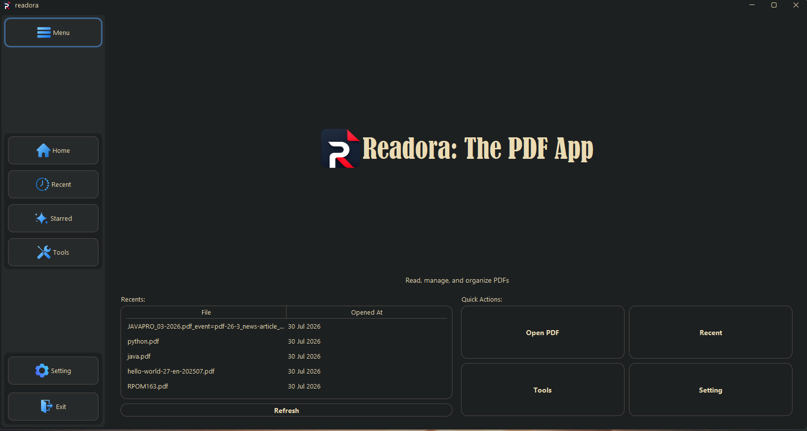
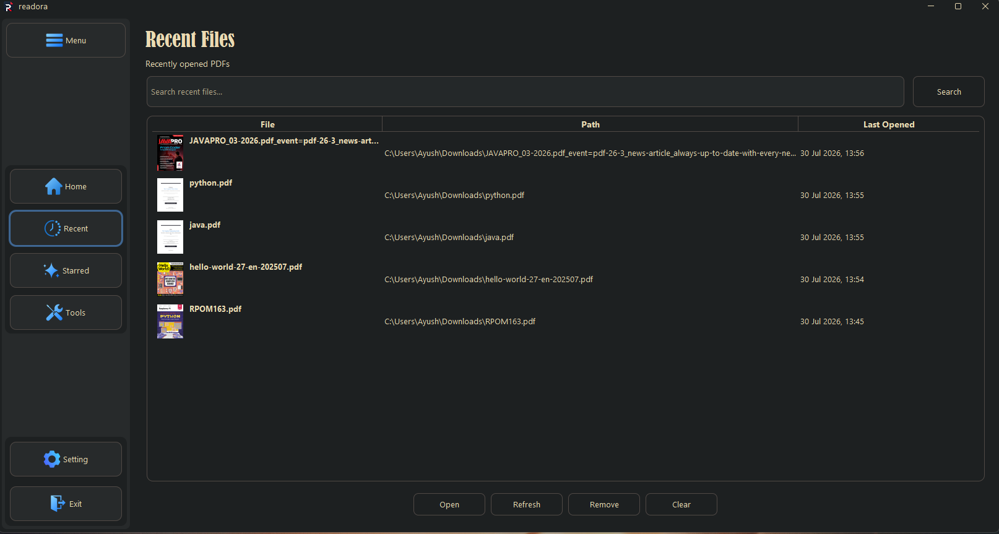
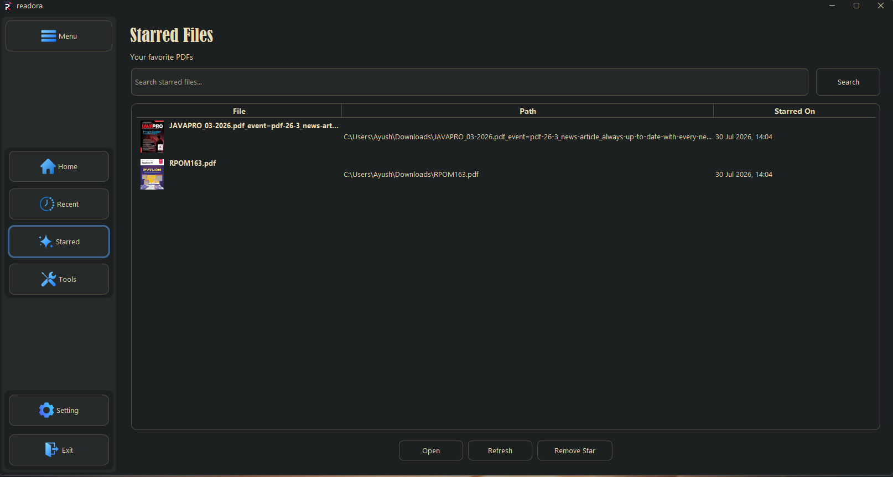
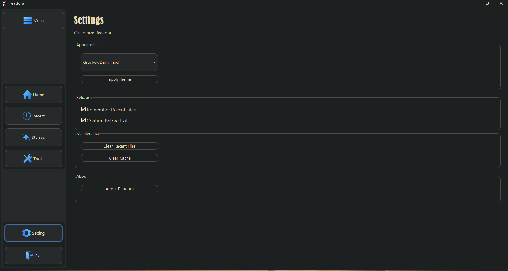
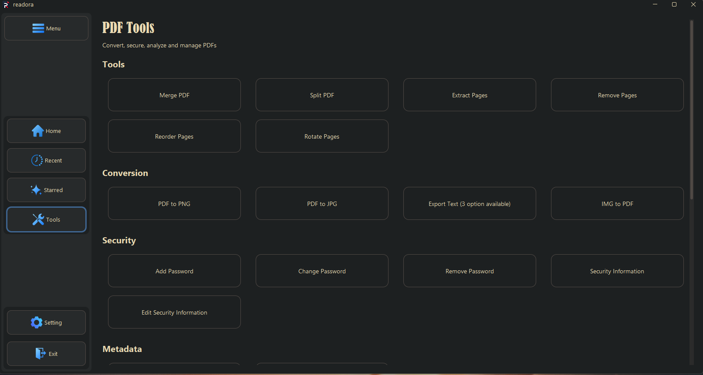
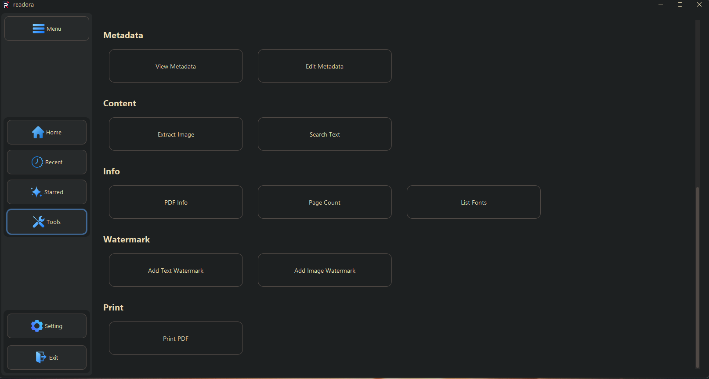
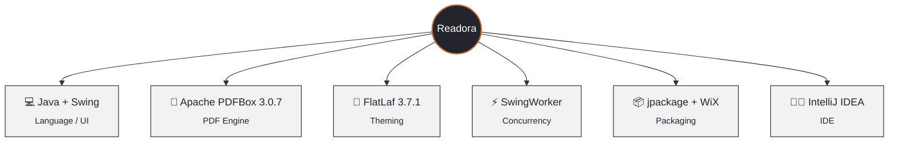
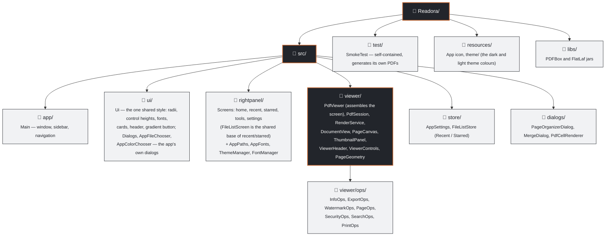

# Readora: The PDF App

<div align="center">


**Read, manage, and organize PDFs** — a lightweight desktop reader and utility toolkit built in Java Swing.

<p>


</p>

<p>


</p>

</div>

<br/>

## 📑 Table of Contents

* [📸 **Screenshots**](#-screenshots)
* [🚀 **Overview**](#-overview)
* [✨ **Features**](#-features)
* [🧰 **Tech Stack**](#-tech-stack)
* [🗂️ **Project Structure**](#-project-structure)
* [📥 **Installation**](#-installation)
* [🏗️ **Building from Source**](#-building-from-source)
* [🧪 **Testing**](#-testing)
* [⚠️ **Known Limitations**](#-known-limitations)

<br/>

## 📸 Screenshots

<table>
<tr>
<td align="center" width="50%"><b>🏠 Home</b><br/><sub>Recent-files preview and quick actions</sub><br/><br/></td>
<td align="center" width="50%"><b>🕘 Recent Files</b><br/><sub>Searchable table with cached thumbnails</sub><br/><br/></td>
</tr>
<tr>
<td align="center" width="50%"><b>⭐ Starred Files</b><br/><sub>Favorited PDFs</sub><br/><br/></td>
<td align="center" width="50%"><b>⚙️ Settings</b><br/><sub>Theming and preferences</sub><br/><br/></td>
</tr>
<tr>
<td align="center" width="50%"><b>🛠️ Tools</b><br/><sub>Page operations, conversion, security</sub><br/><br/></td>
<td align="center" width="50%"><b>🛠️ Tools</b><br/><sub>Metadata, content, info, watermark, print</sub><br/><br/></td>
</tr>
<tr>
<td align="center"><b>📖 Viewer — Dark</b><br/><sub>Lazy-rendered pages, thumbnails, zoom and fit</sub><br/><br/></td>
<td align="center"><b>📖 Viewer — Light</b><br/><sub>The same screen in Readora Light</sub><br/><br/></td>
</tr>
</table>

<br/>

## 🚀 Overview

Readora is a Java Swing desktop application for viewing and working with PDF documents, built around [Apache PDFBox](https://pdfbox.apache.org). It combines a standard PDF viewer — page rendering, thumbnails, zoom, and in-document search — with a full set of everyday PDF utilities: page operations, watermarking, security, merging, and format conversion, all inside one consistent, uncluttered interface.

<br/>

## ✨ Features


**👁️ Viewing & Navigation**
- Crisp page rendering at true 96-DPI scale (HiDPI-aware), with thumbnails, zoom (10-400%), and fit-to-width / fit-to-page
- Pages render lazily on a background thread into a size-bounded cache, so a 300-page PDF opens instantly and uses little memory
- Mixed page sizes and rotated pages lay out correctly
- Ctrl + mouse wheel zoom, drag to pan, keyboard shortcuts, and drag-and-drop a PDF onto the window to open it
- In-document text search with every match highlighted

**ℹ️ Metadata & Info**
- View and edit document metadata
- Page count and a list of fonts used in the document

**✂️ Page Operations**
- Split, extract, remove, reorder, and rotate pages

**🖋️ Watermarking**
- Text and image watermarks, with automatic resolution of a real, embeddable system font

**🔒 Security**
- Add, change, or remove a password
- View security information and edit permissions

**🔗 Merge & Convert**
- Merge multiple PDFs with a reviewable page order
- Convert a set of images into a single PDF

**📤 Export**
- Export pages to PNG / JPG
- Export text to TXT, HTML, or Markdown
- Extract embedded images from a document

**⭐ Recent, Starred & Settings**
- Cached, asynchronously-loaded thumbnails
- Two custom themes built from the app icon — **Readora Dark** and **Readora Light** — switchable instantly in Settings, with matching title bars, dialogs and file pickers (no stock Swing dialogs)
- Configurable preferences

<br/>

## 🧰 Tech Stack



> No build-automation tool (Maven/Gradle) is used — dependencies in `libs/` are added directly to the classpath.

<br/>

## 🗂️ Project Structure



### Look and feel

Both themes are plain FlatLaf property files in `resources/theme/` (`FlatDarkLaf.properties`, `FlatLightLaf.properties`); the colours come from the app icon. To tweak the palette, edit those files — every screen, dialog and title bar follows. Shape (corner radii, control height, spacing) lives in one place, `ui/Ui.java`. Dialogs are never `JOptionPane`/`JFileChooser` directly: use `ui.Dialogs`, `ui.AppFileChooser` and `ui.AppColorChooser`, which have the same method signatures but render in the app's own style.

### How the viewer works

- **`PdfSession`** owns the open document, its password, and a *safe rewrite*: edits are saved to a temp file and swapped in only on success, so a failed save can never lose your PDF.
- **`RenderService`** renders on one background thread. Visible pages come first, then prefetch, then thumbnails; results go into byte-bounded LRU caches. A page that fails to render shows a placeholder instead of stopping the rest.
- **`PageCanvas`** is a single component that paints only the pages in view, so memory and startup time don't grow with page count.
- **Background tools** (export, split, watermark, search, print) work on their own copy of the document, never the one being rendered.

<br/>

## 📥 Installation

Download the latest build from the [**Releases**](../../releases) page.

### 🪟 Windows
- Run `Readora-1.0.0.exe` or `Readora-1.0.0.msi` to install, **or**
- Use the portable build — unzip and run `Readora.exe`, no installation needed

> ⚠️ **Note:** the installers are not code-signed (a signing certificate has an ongoing cost not justified for this project at this stage), so Windows SmartScreen may flag them as being from an unrecognized publisher on first run. This is expected and not an indication of a problem with the installer.

### 🐧 Linux
- Debian / Ubuntu: `sudo dpkg -i readora_1.0.0_amd64.deb`
- Fedora / RHEL: `sudo rpm -i readora-1.0.0-1.x86_64.rpm`

### ☕ Any platform with Java 17+
Download `Readora-v1.0.0-jar.zip`, unzip, and run `java -jar Readora.jar`.

<br/>

## 🏗️ Building from Source

You need a **JDK 17 or newer**. No Maven/Gradle — dependencies are in `libs/`.

```bash
./build.sh          # compile and create dist/Readora.jar (+ dist/libs)
./build.sh run      # build and launch
./build.sh test     # build and run the automated tests
./build.sh clean
```

On Windows use `build.bat` with the same arguments.

**In an IDE:** open the folder, add the jars in `libs/` to the classpath, mark `src`, `test` and `resources` as source roots, and run `app.Main`.

Installers are made with `jpackage`; see [RELEASING.md](RELEASING.md).

<br/>

## 🧪 Testing

`./build.sh test` runs `test/viewer/SmokeTest.java`, which generates its own PDFs and checks the parts that can lose data or silently break: the Recent/Starred store (including file names with commas and the old CSV format), page geometry for mixed-size and rotated pages, the safe-rewrite path (failure leaves the original untouched), password add/remove, search hit counts, and watermarking on a copy. It runs headless and is executed by CI on Windows, macOS and Linux for every push.

<br/>

## ⚠️ Known Limitations

- 🧪 Tests cover the document/storage logic but not the Swing screens themselves; UI behaviour is verified manually
- 🔎 Search highlights assume upright text; on rotated pages a highlight may be offset
- 🖼️ Pages above ~36 megapixels (e.g. an A0 poster at 400%) are rendered at a capped resolution to stay within memory
- 🔓 Installers are unsigned (see note above)

<br/>

---

<div align="center">

Built independently as part of a 12-week industrial training internship.

**Made with ☕ and Java Swing**

</div>
