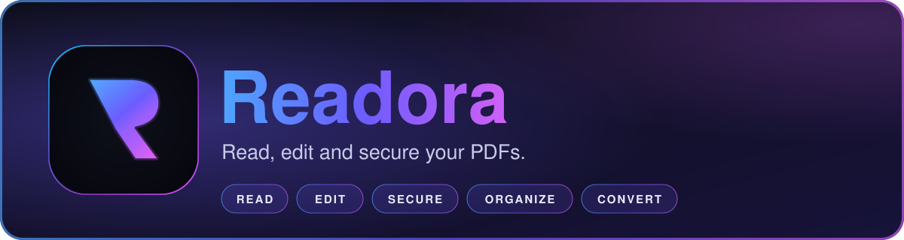
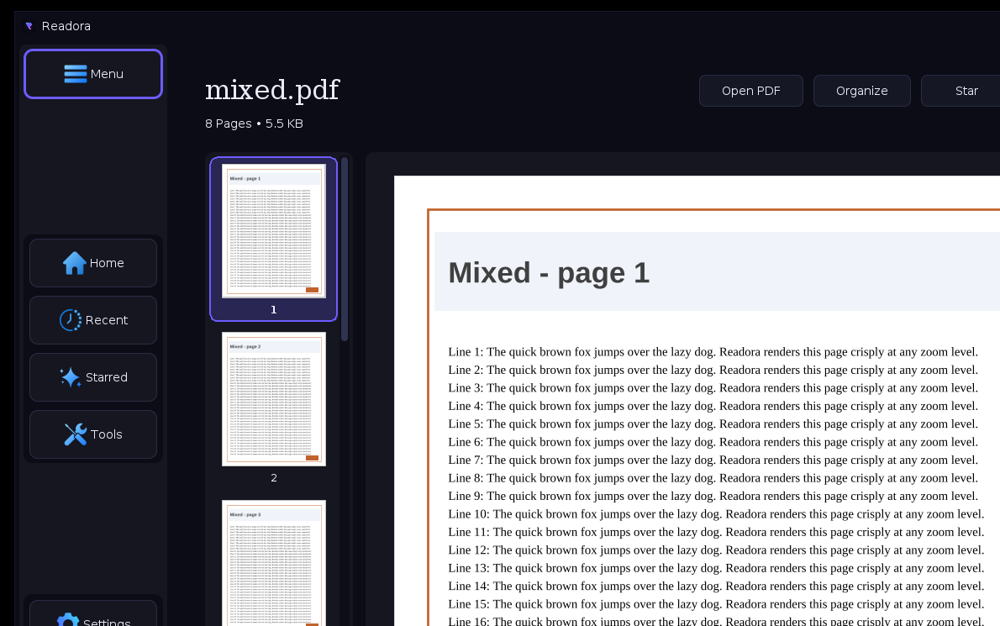
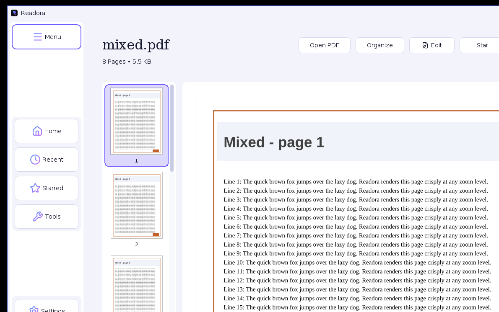
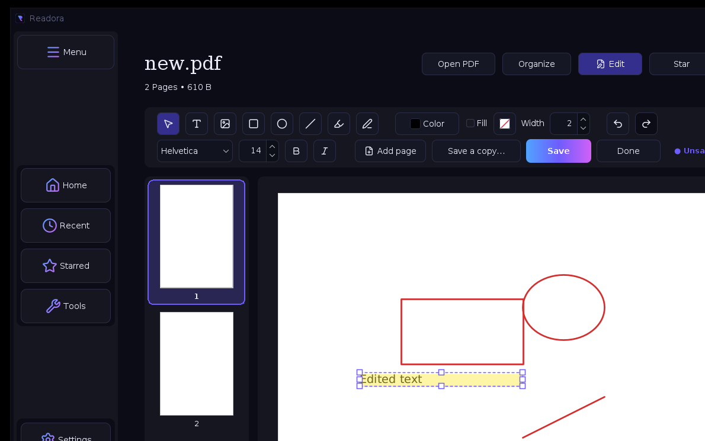
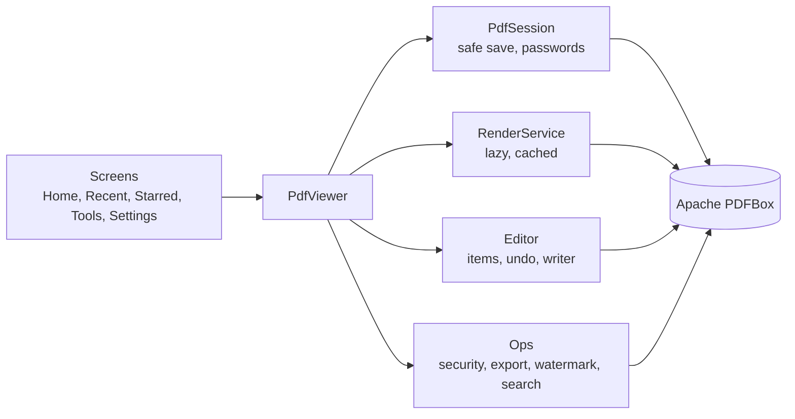

<p align="center">
  
</p>

<p align="center">
  <a href="../../releases"></a>
  
  
  
  
  
</p>

<p align="center">
  <b>A fast, good-looking desktop PDF app. Read, create, edit, protect, redact, organize and convert your PDFs, all offline.</b><br/>
  <sub>Built with Java Swing, Apache PDFBox and FlatLaf. No cloud, no accounts, no uploads.</sub>
</p>

<p align="center">
  <a href="#-features">Features</a> &bull;
  <a href="#-screenshots">Screenshots</a> &bull;
  <a href="#-install">Install</a> &bull;
  <a href="#-quick-start">Quick start</a> &bull;
  <a href="#-shortcuts">Shortcuts</a> &bull;
  <a href="#-security">Security</a> &bull;
  <a href="#-build-from-source">Build</a> &bull;
  <a href="#-roadmap">Roadmap</a>
</p>

---

## ✨ Features

<table>
<tr>
<td width="50%" valign="top">

### 📖 Read
- Crisp pages at true 96-DPI, HiDPI aware, zoom 10-400%
- Lazy background rendering with a memory-bounded cache: a **300-page PDF stays around 35 MB**
- Thumbnails, fit width / fit page, mixed page sizes and rotated pages
- Search with every hit highlighted, print, drag to pan, `Ctrl` + wheel to zoom

</td>
<td width="50%" valign="top">

### ✏️ Create & edit
- **New PDF** in A4, Letter, Legal, A3 or A5, portrait or landscape
- Add **text boxes, pictures, shapes, a highlighter and a freehand pen** to any PDF
- Select, move, resize, duplicate, undo/redo; one-key tool shortcuts
- Edits are real PDF content, placed correctly even on rotated pages

</td>
</tr>
<tr>
<td width="50%" valign="top">

### 🔒 Security & privacy
- **Protect** with open and/or permissions passwords, **AES-256** (or AES-128), strength meter and a one-click generator
- **True redaction**: the covered text is destroyed in the file, not just hidden
- **Remove hidden data**: metadata, attachments, scripts, comments, bookmarks
- Protected files stay out of Recent and are never previewed

</td>
<td width="50%" valign="top">

### 🗂 Organize & convert
- Organizer for reorder, rotate, delete and extract pages
- Merge, split, extract and reorder
- PDF to PNG / JPG, export text as TXT / HTML / Markdown, images to PDF
- Text and image watermarks, metadata editor, fonts list, extract embedded images

</td>
</tr>
<tr>
<td width="50%" valign="top">

### 🧭 Open it your way
- Appears in the file manager's **Open with** list
- **Drag a PDF anywhere** onto the window, or onto the app icon
- `Readora file.pdf` from the command line
- Recent files on the Home screen with **first-page previews**

</td>
<td width="50%" valign="top">

### 🎨 Made to look good
- Two custom themes, **Readora Dark** and **Readora Light**, switchable instantly
- Themed title bars and dialogs: no stock Swing pop-ups
- Every icon is **vector (SVG)**, sharp at any scale
- Safe saving: a file is replaced only after a successful write

</td>
</tr>
</table>

## 📸 Screenshots

<table>
<tr>
<td align="center" width="50%"><b>Viewer, dark</b><br/><br/></td>
<td align="center" width="50%"><b>Viewer, light</b><br/><br/></td>
</tr>
<tr>
<td align="center" colspan="2"><b>Editor: text, shapes, highlighter, pen, pictures and redaction</b><br/><br/></td>
</tr>
</table>

## 📦 Install

Download from the [**Releases**](../../releases) page. The installers bundle their own Java runtime, so you do not need Java installed.

| Platform | Download | Notes |
|---|---|---|
| 🪟 **Windows** | `Readora-1.0.0.exe` or `.msi` | Adds Readora to **Open with** for PDFs |
| 🪟 Windows portable | `Readora-1.0.0-portable-windows.zip` | Unzip and run `Readora.exe` |
| 🐧 **Debian / Ubuntu** | `readora_1.0.0_amd64.deb` | `sudo apt install ./readora_1.0.0_amd64.deb` |
| 🐧 **Fedora / RHEL** | `readora-1.0.0-1.x86_64.rpm` | `sudo dnf install ./readora-1.0.0-1.x86_64.rpm` |
| 🐧 **Arch** | `readora-1.0.0-1-x86_64.pkg.tar.gz` | `sudo pacman -U readora-1.0.0-1-x86_64.pkg.tar.gz` |
| ☕ **Any OS with Java 17+** | `Readora-v1.0.0-jar.zip` | Unzip, then `java -jar Readora.jar` (also covers macOS) |

> ⚠️ **Windows SmartScreen:** the installers are not code-signed (a certificate has an ongoing cost), so Windows may say "unrecognized publisher" on first run. Choose *More info*, then *Run anyway*.

## 🚀 Quick start

1. **Open** a PDF: drag it onto the window, click the drop zone on Home, or use **Open PDF**.
2. **Edit** it: press **Edit**, pick a tool, click or drag on the page, then **Save**.
3. **Start from nothing**: **New PDF** on Home, choose a size, and you are in the editor.
4. **Protect** it: **Tools, Add Password**, or **Remove Hidden Data** before you share a file.

## 🎹 Shortcuts

| Viewer | | Editor | |
|---|---|---|---|
| `Ctrl` + wheel | Zoom | `V` `T` `I` | Select, Text, Picture |
| `Ctrl` `+` / `-` / `0` | Zoom in / out / 100% | `R` `O` `L` | Rectangle, Ellipse, Line |
| `Alt` + `←` / `→` | Previous / next page | `H` `P` `X` | Highlighter, Pen, **Redact** |
| `Home` / `End` | First / last page | `Ctrl` + `Z` / `Y` | Undo / redo |
| `PgUp` / `PgDn` | Scroll a screen | `Ctrl` + `S` / `D` | Save / duplicate |
| Drag | Pan the page | `Delete`, arrows | Remove, nudge (`Shift` = 10 pt) |

## 🔒 Security

<table>
<tr><th>You want to...</th><th>Use</th><th>What actually happens</th></tr>
<tr><td>Keep a file private</td><td><b>Open password</b></td><td>The contents are encrypted (AES-256). Nobody can read it without the password.</td></tr>
<tr><td>Let people read but not copy or edit</td><td><b>Permissions password</b> + restrictions</td><td>Anyone can open it; printing, copying, editing and so on are blocked unless the permissions password is given.</td></tr>
<tr><td>Hide a name or number for good</td><td><b>Redact</b> tool</td><td>The page is flattened to an image with the area blacked out, so the underlying text is <i>gone from the file</i>, not just covered. Other pages are untouched.</td></tr>
<tr><td>Share without leaking author, edits, notes</td><td><b>Remove Hidden Data</b></td><td>Scans for and removes metadata, attachments, scripts, comments and bookmarks, into a cleaned copy.</td></tr>
</table>

Changing or removing protection requires the **permissions** password, so a restricted file cannot be unlocked with only its open password. A black rectangle drawn in other tools often only *covers* text; Readora's redaction destroys it, at the cost that redacted pages become images (their text can no longer be selected or searched).

## 🧩 Architecture



- **Safe saving:** edits go to a temporary file and replace the original only after a successful write.
- **Background work** (export, split, watermark, search) runs on its own copy of the document, never the one being drawn.
- **One shared look:** every radius, size and colour comes from `ui/Ui.java` and the two theme files in `resources/theme/`.

<details>
<summary><b>Project layout</b></summary>

```text
src/
  app/          Main window, file association, app info
  ui/           Ui (shared style), Dialogs, AppFileChooser, SVG renderer and icons
  rightpanel/   Screens: home, recent, starred, tools, settings, themes
  viewer/       PdfViewer, PdfSession, RenderService, DocumentView, thumbnails
    edit/       EditModel (undo/redo), EditItem, EditWriter, Redactor, PageSpace
    ops/        Security, Sanitizer, export, watermark, search, print
  store/        Settings and the Recent / Starred lists
  dialogs/      Page Organizer, Merge
resources/      icons/ (SVG), logo.svg, theme/ (dark and light)
packaging/      Installer icons and file associations
scripts/        package.sh, package.bat, IconExport.java
test/           Self-contained test suite
```
</details>

## 🔧 Build from source

You need a **JDK 17 or newer**. There is no Maven or Gradle; the two dependencies are in `libs/`.

```bash
./build.sh          # compile and create dist/Readora.jar
./build.sh run      # build and launch
./build.sh test     # build and run the 159 automated checks
```

On Windows use `build.bat` with the same arguments. In IntelliJ, mark `resources` as a **Resources Root** (so the SVG icons are packed into the jar) and `test` as test sources.

<details>
<summary><b>Make installers</b></summary>

`scripts/package.sh` (Linux) and `scripts\package.bat` (Windows) wrap `jpackage`; the full guide, including the Arch package, is in [RELEASING.md](RELEASING.md). Each installer must be built on its own operating system.
</details>

## 🧪 Tests

`./build.sh test` generates its own PDFs and checks the parts that can lose data or silently break: safe saving (including encrypted files), page geometry, the editor (every item type pixel-checked on pages rotated 0/90/180/270), **redaction (the secret is searched for in the saved file's raw bytes)**, hidden-data cleaning, AES encryption, the SVG renderer and every icon name, themes, and the Open-with and drag-and-drop logic. It runs headless in CI on Windows, macOS and Linux.

## 🚧 Known limits

- Installers are unsigned (see the SmartScreen note above).
- Search highlights assume upright text and may be offset on rotated pages.
- Pages above about 36 megapixels (for example an A0 poster at 400%) render at a capped resolution.
- Redacted pages become images; you choose that trade-off when you save.
- The portable build keeps its settings and Recent list in your user profile, like most portable apps.
- The automated tests cover the logic, not the Swing screens; the screens are checked by hand.

## 🧭 Roadmap

Ideas for v2 (an in-viewer find bar, selecting and copying text, form filling and signing, real annotations, compression and OCR) are in [ROADMAP.md](ROADMAP.md). What changed in each release is in [CHANGELOG.md](CHANGELOG.md).

## 🙏 Credits

[Apache PDFBox](https://pdfbox.apache.org/) and [FlatLaf](https://www.formdev.com/flatlaf/) do the heavy lifting; the interface icons are from [Lucide](https://lucide.dev/). Full licence texts are in [THIRD_PARTY_NOTICES.md](THIRD_PARTY_NOTICES.md).

## 📄 License

No license has been chosen yet, so all rights are reserved for now. Add a `LICENSE` file and update this section before you accept contributions.

---

<p align="center"><sub>Made with Java, Swing and a lot of coffee. Developed by Ayush.</sub></p>
